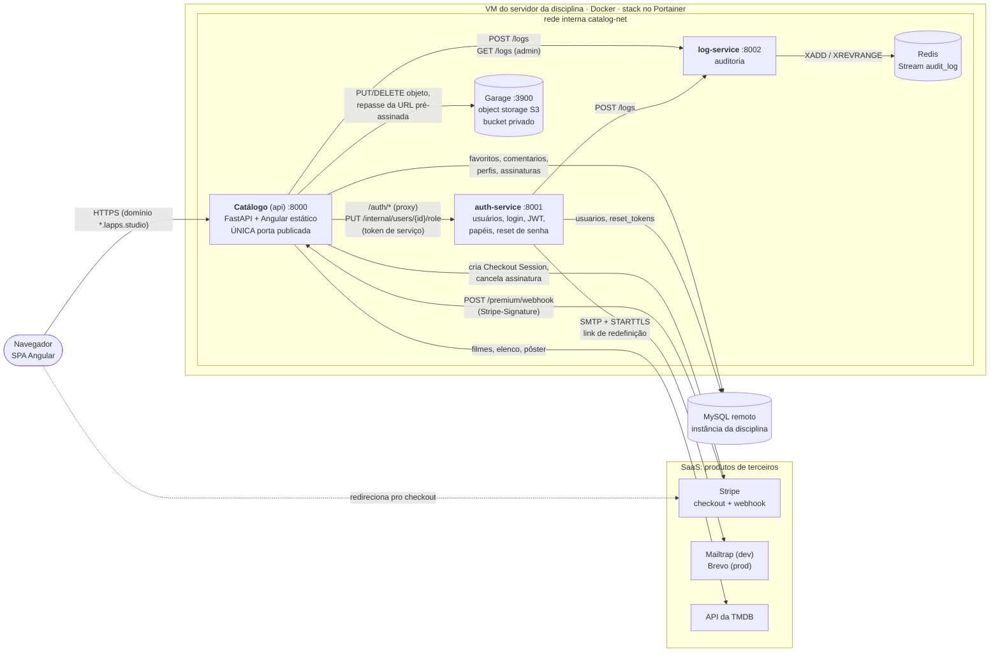
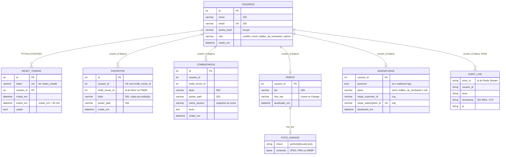

# Documentação reversa — Catálogo de Filmes do Tom Hanks

> Atividade 8 (ISW055), proposta pelo professor [@siriani](https://github.com/siriani). Voltar pro [README técnico herdado](docs/README-catalogo-filmes.md).

Este documento foi escrito como se o sistema tivesse acabado de ser herdado de outra pessoa: nenhuma linha de código nova, só leitura do que já existe. Toda regra listada aqui aponta pro arquivo de onde foi tirada. Onde o código faz algo diferente do que se esperaria (ou diferente do que o README diz), isso está registrado na seção [Achados da leitura](#5-achados-da-leitura).

**Sumário**
1. [Especificação: o que o sistema faz](#1-especificação-o-que-o-sistema-faz)
2. [Arquitetura](#2-arquitetura)
3. [Regras de negócio](#3-regras-de-negócio)
4. [Modelo de dados](#4-modelo-de-dados)
5. [Achados da leitura](#5-achados-da-leitura)

---

## 1. Especificação: o que o sistema faz

Um site sobre os filmes do Tom Hanks com cara de rede social pequena. Qualquer pessoa vê a página inicial; quem cria conta navega pelo catálogo e, conforme o plano, favorita, comenta e joga um quiz. Um administrador modera o conteúdo e consulta o log de auditoria.

### 1.1 Quem usa

| Perfil | Como chega nele | O que enxerga |
|---|---|---|
| Visitante | Sem conta | Landing page (`/`) com os três planos, telas de login, cadastro e "esqueci minha senha" |
| 🍿 Cinéfilo | Todo cadastro nasce aqui (grátis) | Catálogo, detalhes de cada filme, perfis (o próprio e os dos outros), página de planos |
| 🤓 Nerd | Paga R$ 19,90/mês no Stripe | Tudo do Cinéfilo + favoritar e comentar |
| 🕵️ Stalker do Tom Hanks | Paga R$ 9.999,90/mês no Stripe | Tudo do Nerd + quiz do pôster pixelado |
| Admin | Promovido por outro admin (o primeiro, direto no banco) | Tudo do Stalker + moderação, gestão de papéis e log de auditoria |

### 1.2 Funcionalidades

**Cadastro e login.** A pessoa informa nome, e-mail e senha (mínimo 8 caracteres) e já sai logada. O login devolve um token (JWT) que o navegador guarda e manda em toda chamada. Sair da conta apaga o token do navegador. Se qualquer chamada voltar `401` (token vencido ou adulterado), o front desloga sozinho e manda pra tela de login.

**Esqueci minha senha.** Em `/esqueci-senha` a pessoa digita o e-mail e recebe um link por e-mail (válido por 30 minutos). O link abre `/redefinir-senha?token=...`, onde ela escolhe a senha nova. A tela diz a mesma coisa exista ou não uma conta com aquele e-mail.

**Catálogo de filmes.** Lista paginada (20 por página) de todos os filmes em que o Tom Hanks atuou, do mais novo pro mais antigo, com busca por título. Os dados vêm ao vivo da API da TMDB e não são gravados em lugar nenhum. Abrir um filme mostra o elenco principal (10 atores) e onde assistir no Brasil (assinatura, aluguel ou compra).

**Favoritos** (Nerd ou acima). Marca um filme como favorito, lista os próprios favoritos (`/app/favoritos`) e desmarca. Os favoritos aparecem também no perfil público da pessoa.

**Comentários** (Nerd ou acima). Comenta num filme, lê a conversa de qualquer filme (com o nome de quem escreveu e link pro perfil dele), vê o histórico dos próprios comentários (`/app/comentarios`) e apaga os próprios.

**Perfil.** Cada pessoa tem uma página (`/app/perfil/:id`) com nome, foto, bio de até 280 caracteres, selo do plano pago e lista de favoritos. Qualquer pessoa logada vê o perfil de qualquer outra; só o dono edita o seu.

**Foto de perfil (avatar).** Upload de JPEG, PNG ou WEBP de até 2 MB. O servidor confere que o arquivo é imagem de verdade, reduz pra no máximo 1024 px de lado e remove os metadados (EXIF, inclusive GPS). A foto aparece no perfil e no cabeçalho do site, servida por um link temporário que expira em 15 minutos.

**Planos pagos.** Em `/app/planos` a pessoa escolhe Nerd ou Stalker e é levada pra página de pagamento do Stripe (modo de teste; cartão `4242 4242 4242 4242`). Ao voltar, a tela espera a confirmação do pagamento, atualiza o token e libera o menu novo sem precisar sair e entrar de novo. Trocar de Nerd pra Stalker cancela a assinatura antiga. Se a assinatura for cancelada no Stripe, a pessoa volta pro Cinéfilo.

**Quiz do pôster pixelado** (Stalker ou acima). O sistema sorteia um filme, mostra o pôster pixelado e quatro títulos. A pessoa escolhe um e recebe se acertou, junto com o pôster original, a sinopse, a data e a nota.

**Administração** (só admin, `/app/admin`).
- Moderação: lista e apaga comentários e favoritos de qualquer usuário.
- Gestão de usuários: lista todos os usuários e troca o papel de qualquer um.
- Log de auditoria: consulta os últimos eventos (até 1000) — quem fez o quê, quando e de qual IP.

### 1.3 Telas (rotas do Angular)

| Rota | Quem acessa | Tela |
|---|---|---|
| `/` | todos | Landing com os planos |
| `/login`, `/registro`, `/esqueci-senha` | só deslogado | Autenticação |
| `/redefinir-senha` | todos | Nova senha a partir do link do e-mail |
| `/app` | logado | Catálogo |
| `/app/perfil`, `/app/perfil/:id` | logado | Próprio perfil / perfil de outro |
| `/app/planos` | logado | Planos e volta do checkout |
| `/app/favoritos`, `/app/comentarios` | logado (a API exige Nerd) | Meus favoritos / meus comentários |
| `/app/quiz` | Stalker ou acima | Quiz |
| `/app/admin` | admin | Moderação, usuários e log |

Fonte: `frontend/src/app/app.routes.ts`. Os guards do Angular só escondem telas; quem barra de verdade é a API (ver [3.2](#32-papéis-e-planos)).

---

## 2. Arquitetura

### 2.1 Visão geral

### 2.2 Os serviços

| Serviço | Pasta / imagem | Responsabilidade | Dono de quais dados | Porta |
|---|---|---|---|---|
| **Catálogo** (`api`) | `app/` + `frontend/` · `ghcr.io/leonardoricci-tsi/api-filmes` | Porta de entrada pública. Serve o Angular compilado, a API de filmes, favoritos, comentários, perfis, planos, quiz e admin. Repassa `/auth/*` pro auth-service e a foto pro Garage | `favoritos`, `comentarios`, `perfis`, `assinaturas` | `8000` publicada (`8215` no host de produção) + `9100` interna (métricas) |
| **auth-service** | `auth-service/` · `api-filmes-auth` | Cadastro, login, emissão do JWT, papéis, recuperação de senha por e-mail | `usuarios`, `reset_tokens` | `8001` só interna |
| **log-service** | `log-service/` · `api-filmes-log` | Recebe eventos de auditoria e devolve os últimos pra admin | Stream `audit_log` no Redis | `8002` só interna |
| **Redis** | `redis:7-alpine` | Armazena o log de auditoria | — | `6379` só interna |
| **Garage** | `garage/` · `api-filmes-garage` | Guarda os arquivos de foto de perfil (API S3) | Objetos `perfis/{usuario_id}/{uuid}.{ext}` | `3900` só interna |
| **MySQL** | fora do compose | Banco relacional, uma instância compartilhada pelos dois serviços, cada um com seu histórico do Alembic | todas as tabelas acima | remota |

Prometheus e Grafana existem só no `docker-compose.yml` local (observabilidade); não fazem parte da stack de produção (`docker-compose.portainer.yml`).

### 2.3 Como os serviços conversam

- **Um único ponto de entrada.** Só o catálogo tem `ports:`. Os outros usam `expose:` e são alcançados pelo nome do serviço dentro da rede `catalog-net` (`http://auth-service:8001`, `http://log-service:8002`, `http://garage:3900`).
- **JWT verificado localmente.** O auth-service assina o token (HS256, claims `sub`, `role`, `nome`, `exp`). Catálogo e log-service conferem a assinatura com o mesmo `JWT_SECRET`, sem chamar o auth-service a cada requisição.
- **Proxy de autenticação.** `POST /auth/register`, `/login`, `/refresh`, `/forgot-password`, `/reset-password`, `GET /auth/me` e as rotas `/auth/admin/*` chegam no catálogo e são repassadas como estão (`app/routers/auth.py`, `app/services/auth_client.py`). Se o auth-service não responder, o catálogo devolve `502`.
- **Auditoria fire-and-forget.** Catálogo e auth-service mandam `POST /logs` com timeout de 5 s e ignoram qualquer falha (`app/services/log_client.py`).
- **Foto por URL pré-assinada.** O catálogo grava no Garage pela rede interna, mas assina a URL com o domínio público. O navegador pede a foto ao próprio catálogo, que repassa o caminho e a query intactos pro Garage (`app/routers/storage_proxy.py`). Quem valida a assinatura e a expiração é o Garage.
- **Pagamento em dois caminhos.** O navegador vai ao Stripe e volta; a confirmação chega por outro caminho, o webhook. O webhook pede ao auth-service a troca de papel usando um token de serviço (`servico: "catalogo"`, sem `sub`, 1 minuto de validade).

### 2.4 Deploy

`git push` na `main` → GitHub Actions roda os testes, builda as 4 imagens e sobe a stack inteira num smoke test → publica no GHCR com a tag `sha-xxxxxxx` → um commit automático atualiza as tags do `docker-compose.portainer.yml` → o Portainer percebe a mudança no repositório (GitOps) e recria os containers. Detalhes no [README](docs/README-catalogo-filmes.md#cicd-github-actions-atividade-extra).

---

## 3. Regras de negócio

Formato: **se X, então Y** — com o arquivo de onde a regra foi tirada.

### 3.1 Cadastro, login e sessão

| # | Regra | Onde |
|---|---|---|
| A1 | Se o e-mail já está cadastrado, o cadastro é recusado com `400 "Email já cadastrado"`. | `auth-service/app/routers/auth.py` |
| A2 | Se a senha tem menos de 8 ou mais de 72 caracteres, o cadastro (e a redefinição) é recusado com `422`. O teto de 72 é o limite do bcrypt. | `auth-service/app/schemas/auth.py`, `schemas/password_reset.py` |
| A3 | Se alguém se cadastra, ele nasce com o papel `cinefilo` e já recebe um token, sem precisar logar depois. | `auth-service/app/routers/auth.py` |
| A4 | Se o e-mail não existe **ou** a senha não bate, o login responde a mesma coisa (`401 "Email ou senha inválidos"`), sem dizer qual dos dois errou. | `auth-service/app/routers/auth.py` |
| A5 | Se o login dá certo, então é registrado o evento `login` na auditoria. Login que falha não é registrado. | `auth-service/app/routers/auth.py` |
| A6 | Se o token não tem assinatura válida, está vencido (`JWT_EXPIRE_MINUTES`, padrão 60) ou não tem `sub`/`role`, a requisição recebe `401`. | `app/auth/dependencies.py` |
| A7 | Se o front recebe `401` de qualquer rota, ele apaga o token e manda pra `/login`. | `frontend/src/app/core/interceptors/auth.interceptor.ts` |
| A8 | Se alguém chama `POST /auth/logout`, o servidor não invalida nada (JWT não tem estado); só registra o evento `logout`. O botão "Sair" do front não chama essa rota (ver [achado 12](#5-achados-da-leitura)). | `app/routers/auth.py`, `frontend/src/app/layout/header/header.ts` |
| A9 | Se o papel do usuário mudou no banco, o token antigo continua com o papel velho até o usuário chamar `POST /auth/refresh` ou o token expirar. | `auth-service/app/routers/auth.py` |
| A10 | Senha nunca é gravada em texto: só o hash bcrypt. | `auth-service/app/auth/security.py` |

### 3.2 Papéis e planos

Os papéis formam uma escada — cada um inclui os anteriores: `cinefilo` (1) < `nerd` (2) < `stalker_do_tomhanks` (3) < `admin` (4).

| # | Regra | Onde |
|---|---|---|
| R1 | Se o papel do token está abaixo de `nerd`, favoritar, listar favoritos, comentar, ler comentários e apagar comentário devolvem `403 "Ação exige papel 'nerd' ou superior"`. | `app/routers/favorites.py`, `comments.py`, `app/auth/dependencies.py` |
| R2 | Se o papel está abaixo de `stalker_do_tomhanks`, o quiz devolve `403`. | `app/routers/quiz.py` |
| R3 | Se o papel não é exatamente `admin`, as rotas `/admin/*` e `/auth/admin/*` devolvem `403 "Acesso restrito a admins"`. | `app/routers/admin.py`, `auth-service/app/auth/dependencies.py` |
| R4 | Se uma ação é negada por papel ou por dono (403), é registrado o evento `acesso_negado:<papel>` ou `acesso_negado:perfil:<id>`. | `app/auth/dependencies.py`, `app/routers/profiles.py` |
| R5 | O papel vem **só** do claim `role` do JWT, nunca do corpo ou dos parâmetros da requisição. | `app/auth/dependencies.py` |
| R6 | Se um admin troca o papel de alguém pra um valor fora de `cinefilo`, `nerd`, `stalker_do_tomhanks`, `admin`, recebe `400`; se o usuário não existe, `404`. | `auth-service/app/routers/admin.py` |
| R7 | Ninguém nasce admin: o primeiro admin é promovido direto no banco (`UPDATE usuarios SET role='admin'`). Não existe endpoint pra isso. | `docs/README-catalogo-filmes.md`, `auth-service/app/routers/auth.py` |
| R8 | Os guards do Angular só escondem telas (quiz, admin). A permissão de verdade é sempre o `403` da API. | `frontend/src/app/core/guards/role.guard.ts` |

### 3.3 Planos pagos (Stripe)

| # | Regra | Onde |
|---|---|---|
| P1 | Só `nerd` e `stalker_do_tomhanks` estão à venda. Se pedir `cinefilo` ou `admin` no checkout, `422`. | `app/routers/premium.py` (`CheckoutIn`) |
| P2 | Se o usuário já tem o plano pedido ou um superior (inclusive admin), o checkout responde `409 "Você já tem esse plano ou um superior"`. | `app/routers/premium.py` |
| P3 | Quem paga é identificado pelo `id` do JWT, gravado em `client_reference_id` da sessão do Stripe — nunca por algo que o cliente mande. | `app/services/pagamentos.py` |
| P4 | Se as chaves do Stripe não estão configuradas, o checkout e o webhook respondem `503`; o resto do sistema funciona normal. | `app/services/pagamentos.py`, `app/config.py` |
| P5 | Se o navegador volta com `?checkout=sucesso`, **nada** é ativado. Só o webhook ativa plano. | `app/routers/premium.py` |
| P6 | Se o webhook chega sem `Stripe-Signature` válida (outro segredo, corpo alterado ou timestamp com mais de 5 min), responde `400` e não toca no banco. | `app/services/pagamentos.py` |
| P7 | Se chega `checkout.session.completed` válido, então: (1) o auth-service troca o papel pro plano pago, (2) só depois a assinatura é gravada com `premium = true`. | `app/routers/premium.py` (`_ativar_plano`) |
| P8 | Se o auth-service falha ao trocar o papel, o webhook responde `502`, nada é gravado e o Stripe reenvia o evento depois. | `app/routers/premium.py` (`_trocar_papel`) |
| P9 | Se o mesmo evento chega duas vezes, o resultado é o mesmo (idempotente). | `app/routers/premium.py` |
| P10 | Se o usuário já tinha uma assinatura e compra outro plano, a assinatura antiga é cancelada no Stripe (melhor esforço). O cancelamento gerado por isso não rebaixa ninguém, porque o banco já guarda o ID da assinatura nova. | `app/routers/premium.py` |
| P11 | Se chega `customer.subscription.deleted` de uma assinatura conhecida, o usuário volta pra `cinefilo` e a assinatura fica `premium = false`, `plano = null`. | `app/routers/premium.py` (`_encerrar_plano`) |
| P12 | Se o usuário é admin, nenhum plano nem cancelamento muda o papel dele. A rota interna também recusa `admin` como papel de plano (`400`). | `auth-service/app/routers/internal.py` |
| P13 | A rota interna de troca de papel só aceita token de serviço (`servico: "catalogo"`, sem `sub`); token de usuário recebe `401`. E token de serviço não serve como login. | `auth-service/app/auth/security.py`, `routers/internal.py` |
| P14 | Na volta do checkout, o front consulta `GET /premium/status` a cada 2 s, por até 15 tentativas; quando o plano aparece, pede um token novo. | `frontend/src/app/features/planos/planos.ts` |
| P15 | Nenhum dado de cartão passa pelo backend nem é gravado; só os IDs `cus_` e `sub_`. | `app/models/assinatura.py` |
| P16 | Eventos do Stripe que não são de ativação nem de cancelamento recebem `200` e são ignorados (erro faria o Stripe reenviar à toa). | `app/routers/premium.py` |

### 3.4 Favoritos e comentários

| # | Regra | Onde |
|---|---|---|
| F1 | Se o usuário favorita um filme que já favoritou, `409 "Filme já favoritado"` (restrição única `usuario_id + tmdb_movie_id`). | `app/routers/favorites.py`, `app/models/favorito.py` |
| F2 | Não há limite de quantidade de favoritos por plano: quem é Nerd ou acima favorita quantos quiser. | `app/routers/favorites.py` |
| F3 | `GET /favorites` lista só os favoritos do usuário logado. | `app/routers/favorites.py` |
| F4 | Se o usuário tenta apagar favorito ou comentário que não é dele (ou que não existe), recebe `404` — não `403`, pra não revelar que o recurso existe. | `app/routers/_ownership.py` |
| F5 | Se o comentário é listado com `tmdb_movie_id`, aparecem os comentários de todo mundo naquele filme; sem o filtro, só os do próprio usuário. | `app/routers/comments.py` |
| F6 | O nome do autor é copiado pro comentário no momento em que ele é criado (vem do claim `nome` do JWT). Se o usuário mudar de nome depois, os comentários antigos mantêm o nome antigo. | `app/routers/comments.py` |
| F7 | Comentário precisa de pelo menos 1 caractere e título de até 500. | `app/schemas/comment.py` |
| F8 | Só admin apaga comentário ou favorito de outro usuário (`DELETE /admin/comments/{id}`, `/admin/favorites/{id}`). | `app/routers/admin.py` |
| F9 | Se um admin apaga comentário de outro, registra `apagar_comentario_moderacao:{id}` com o id do admin (não do autor). | `app/routers/admin.py` |
| F10 | Favoritar registra `favoritar_filme:{tmdb_id}`; comentar registra `comentar:{tmdb_id}`. | `app/routers/favorites.py`, `comments.py` |

### 3.5 Perfil e foto

| # | Regra | Onde |
|---|---|---|
| PF1 | Qualquer usuário logado (inclusive Cinéfilo) vê o perfil de qualquer outro, com nome, bio, foto, selo do plano e favoritos. | `app/routers/profiles.py` |
| PF2 | Se o `usuario_id` da URL é diferente do `sub` do JWT, editar bio ou enviar foto devolve `403 "Você só pode editar o próprio perfil"` — **nem admin passa**. | `app/routers/profiles.py` (`require_dono_do_perfil`) |
| PF3 | Se o usuário nunca editou o perfil, o perfil aparece vazio (não `404`). Se o usuário não existe no auth-service, `404`. | `app/routers/profiles.py` |
| PF4 | Bio tem no máximo 280 caracteres. | `app/schemas/profile.py` |
| PF5 | Se a foto passa de 2 MB, `413`. Se não é JPEG, PNG ou WEBP de verdade (conferido pelos bytes, não pela extensão), ou passa de 25 milhões de pixels, `415`. | `app/services/imagem.py`, `app/routers/profiles.py` |
| PF6 | Toda foto aceita é reduzida pra caber em 1024×1024, girada conforme o EXIF e regravada sem metadados. | `app/services/imagem.py` |
| PF7 | O nome do arquivo no storage é gerado pelo servidor (`perfis/{id}/{uuid}.{ext}`), nunca o nome enviado pelo cliente. | `app/routers/profiles.py` |
| PF8 | Se o Garage está fora, o upload devolve `502` e nada vai pro banco. Se o banco falha depois do upload, o arquivo novo é apagado. A foto antiga só é apagada depois do commit. | `app/routers/profiles.py` |
| PF9 | O banco guarda só a chave do objeto; o link da foto é gerado a cada leitura e expira em 900 s (15 min). | `app/services/storage.py`, `app/config.py` |
| PF10 | Sem URL assinada válida, o Garage recusa a leitura: o bucket é privado. | `app/routers/storage_proxy.py` |
| PF11 | Editar bio registra `atualizar_perfil`; enviar foto registra `upload_foto_perfil`. | `app/routers/profiles.py` |

### 3.6 Redefinição de senha

| # | Regra | Onde |
|---|---|---|
| S1 | Se alguém pede redefinição, a resposta é sempre a mesma ("Se esse email estiver cadastrado..."), exista o e-mail ou não. | `auth-service/app/routers/password_reset.py` |
| S2 | Se o e-mail existe, é gerado um token aleatório (`secrets.token_urlsafe(32)`) e enviado um link `{CATALOG_PUBLIC_URL}/redefinir-senha?token=...`. | `auth-service/app/auth/reset_tokens.py`, `routers/password_reset.py` |
| S3 | O link de redefinição expira em 30 minutos. | `auth-service/app/auth/reset_tokens.py` |
| S4 | Se o token não existe, já foi usado ou expirou, a troca é recusada com a mesma mensagem (`400 "Link inválido, expirado ou já utilizado"`), sem dizer qual foi o motivo. | `auth-service/app/auth/reset_tokens.py` |
| S5 | Se a senha é trocada, o token vira usado na mesma transação e não serve de novo. | `auth-service/app/routers/password_reset.py` |
| S6 | Se o envio do e-mail falha, o erro só vai pro log do container; a resposta pro usuário continua a mesma. | `auth-service/app/services/mailer.py` |

### 3.7 Auditoria

| # | Regra | Onde |
|---|---|---|
| L1 | Todo evento tem `usuario_id`, `acao`, `timestamp` (gerado pelo log-service, em UTC) e `ip`. | `log-service/app/routers/logs.py` |
| L2 | Se o log-service está fora, a ação do usuário acontece normalmente e o evento se perde. | `app/services/log_client.py` |
| L3 | Só admin consulta o log. O catálogo barra com `403` antes de chamar o log-service, e o log-service confere o `role` de novo. | `app/routers/admin.py`, `log-service/app/auth.py` |
| L4 | A consulta devolve do mais recente pro mais antigo, entre 1 e 1000 eventos (padrão 50). | `log-service/app/routers/logs.py` |
| L5 | Abrir checkout, ativar plano e cancelar plano também são auditados (`abrir_checkout:<plano>`, `plano_ativado:<plano>`, `plano_cancelado:<plano>`). | `app/routers/premium.py` |

### 3.8 Catálogo e quiz

| # | Regra | Onde |
|---|---|---|
| C1 | O catálogo é público: `/movies` e `/movies/{id}/detalhes` não exigem login. | `app/routers/movies.py` |
| C2 | Dados de filme nunca são gravados no banco; a lista fica em cache na memória por 5 minutos. Detalhes não têm cache. | `app/services/tmdb.py` |
| C3 | Filmes sem pôster vão pro fim da lista; o resto fica do mais novo pro mais antigo. | `app/services/tmdb.py` |
| C4 | Se a TMDB não responde, o catálogo devolve `502`. | `app/routers/movies.py` |
| C5 | O quiz só sorteia filmes com pôster e exige pelo menos 4 deles. | `app/routers/quiz.py` |
| C6 | A resposta certa nunca vai pro navegador antes do palpite: só um `round_id` assinado, válido por 5 minutos. Rodada vencida ou adulterada: `400`. | `app/routers/quiz.py` |
| C7 | A comparação do palpite ignora maiúsculas/minúsculas e espaços nas pontas. | `app/routers/quiz.py` |

### 3.9 Saúde do sistema

| # | Regra | Onde |
|---|---|---|
| H1 | Se o MySQL cai, `/health` do catálogo e do auth-service devolve `503` e o container fica `unhealthy`. | `app/routers/health.py`, `auth-service/app/routers/health.py` |
| H2 | Se cai o Garage, o auth-service ou o log-service, o catálogo continua `200`, mas com status `degraded`. | `app/routers/health.py` |
| H3 | Se o Redis cai, o `/health` do log-service devolve `503`. | `log-service/app/routers/health.py` |

---

## 4. Modelo de dados

### 4.1 Diagrama entidade-relacionamento

Todas as tabelas ficam na mesma instância MySQL, mas têm donos diferentes. Entre tabelas de serviços diferentes **não há chave estrangeira física**: a ligação é só lógica, pelo `usuario_id` que vem do JWT. A única FK real é `reset_tokens → usuarios`, porque as duas são do auth-service.

### 4.2 Onde cada dado mora

| Entidade | Armazenamento | Dono | Observação |
|---|---|---|---|
| `usuarios` | MySQL | auth-service | Única fonte de nome, e-mail, senha e papel |
| `reset_tokens` | MySQL | auth-service | Tokens antigos não são apagados, só marcados como usados |
| `favoritos` | MySQL | catálogo | Um por (usuário, filme) |
| `comentarios` | MySQL | catálogo | Guarda cópia do nome do autor e do título do filme |
| `perfis` | MySQL | catálogo | Um por usuário; só existe depois da primeira edição |
| `assinaturas` | MySQL | catálogo | É a "sessão premium": um registro por usuário; ausente = plano grátis |
| Log de auditoria | Redis, Stream `audit_log` | log-service | Só cresce; não tem expiração configurada |
| Foto de perfil | Garage, bucket `api-filmes-perfis` | catálogo | O MySQL guarda só a chave |
| Filmes | **lugar nenhum** | TMDB | Lidos ao vivo; o sistema só guarda o `tmdb_movie_id` |
| Sessão de login | **lugar nenhum** no servidor | — | JWT no `localStorage` do navegador |

### 4.3 Migrations

Dois históricos do Alembic no mesmo banco:
- Catálogo: `alembic/versions/` (tabela de controle `alembic_version`). A migration inicial ainda cria `usuarios`; a `d7e4a9b1c3f5_drop_fk_usuarios` remove as FKs de `favoritos`/`comentarios` quando a autenticação virou serviço próprio.
- auth-service: `auth-service/alembic/versions/` (tabela de controle `alembic_version_auth`), com `role`, `reset_tokens` e a escada de papéis.

---

## 5. Achados da leitura

Coisas que o código faz e que não são óbvias, ou que divergem do que o README sugere. Nenhuma foi corrigida nesta atividade (a regra era não escrever código); ficam registradas pra quem mexer depois.

1. **Trocar o papel de alguém pelo painel de admin não é auditado.** `PATCH /auth/admin/users/{id}/role` (`auth-service/app/routers/admin.py`) não chama o log-service. O README diz que o log responde "se um usuário virar admin do nada", mas hoje esse evento não fica registrado. A troca feita pelo Stripe é auditada (`plano_ativado`/`plano_cancelado`).
2. **Algumas exclusões não são auditadas:** o dono apagando o próprio comentário ou favorito, e o admin apagando favorito de outro. Só o apagar comentário por moderação gera evento.
3. **Cinéfilo não lê comentários.** `GET /comments?tmdb_movie_id=` exige `nerd`, então quem está no plano grátis não vê nem a conversa pública de um filme. Já os favoritos de qualquer pessoa aparecem pra ele no perfil (`GET /profiles/{id}` só exige login).
4. **Pedir a redefinição duas vezes deixa dois links válidos.** Gerar um token novo não invalida os anteriores; cada um vale até usar ou expirar.
5. **Redefinir a senha não derruba sessões abertas.** Tokens JWT já emitidos continuam válidos até expirar, porque o JWT não tem estado.
6. **Rebaixar ou cancelar só vale quando o token expira.** Consequência conhecida de o papel morar no JWT (README, "Padrão B"): até `JWT_EXPIRE_MINUTES`, o token antigo ainda carrega o papel pago.
7. **Admin rebaixado à mão não mexe na assinatura.** Se um admin muda o papel de um assinante pelo painel, a linha em `assinaturas` continua `premium = true`, e o selo do plano continua no perfil.
8. **`POST /logs` não tem autenticação.** A proteção é só o isolamento de rede: qualquer container dentro da `catalog-net` consegue gravar um evento com qualquer `usuario_id`.
9. **Falha de e-mail é silenciosa.** Se o SMTP recusar, o usuário vê "você vai receber um link" e nada chega; o erro só aparece no log do container do auth-service.
10. **Comentário não tem tamanho máximo** no schema (`texto: str`, mínimo 1), e a coluna é `TEXT`.
11. **O log de auditoria nunca é podado.** O `XADD` não usa `MAXLEN`; o Stream cresce sem limite enquanto o volume do Redis existir.
12. **O logout pelo site não gera evento de auditoria.** A rota `POST /auth/logout` existe só pra registrar o evento, mas o botão "Sair" (`header.ts` → `AuthService.logout()`) apenas limpa o `localStorage`, sem chamar a API. Pelo uso normal do site, o evento `logout` nunca aparece no log.
