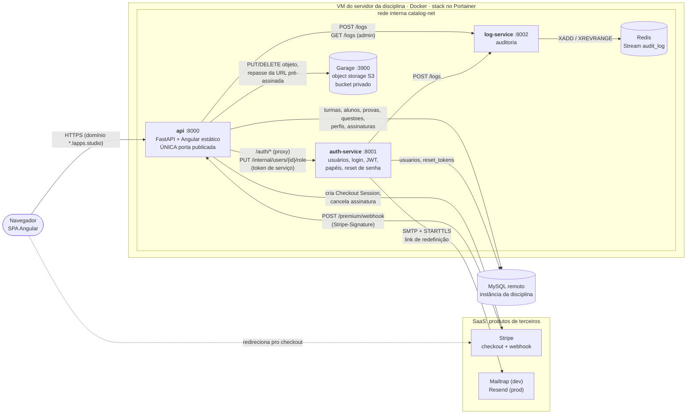
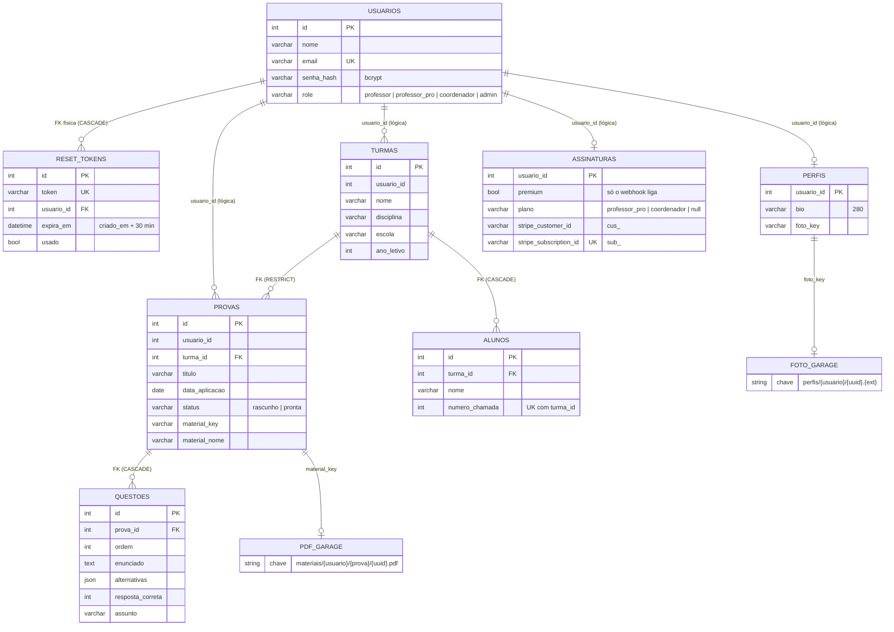

# Documentação do sistema — ProvaPronta

> ISW055, proposta pelo professor [@siriani](https://github.com/siriani). Começou na atividade 8 como documentação reversa do sistema herdado e foi reescrita na atividade 10 para o ProvaPronta. Visão geral e como rodar: [README](README.md).

Toda regra listada aqui aponta para o arquivo de onde foi tirada. O que o código faz de forma não óbvia está em [Achados](#5-achados).

**Sumário**
1. [Especificação: o que o sistema faz](#1-especificação-o-que-o-sistema-faz)
2. [Arquitetura](#2-arquitetura)
3. [Regras de negócio](#3-regras-de-negócio)
4. [Modelo de dados](#4-modelo-de-dados)
5. [Achados](#5-achados)

---

## 1. Especificação: o que o sistema faz

Um SaaS para professores do fundamental e do médio: organizar turmas e alunos, montar provas de múltipla escolha com gabarito, anexar o PDF da apostila e, no plano Pro, gerar uma versão B embaralhada contra cola. Qualquer pessoa vê a landing page; quem cria conta entra no plano Free.

### 1.1 Quem usa

| Perfil | Papel no JWT | Como chega nele | O que pode |
|---|---|---|---|
| Visitante | — | Sem conta | Landing (`/`), login, cadastro, "esqueci a senha" |
| Professor Free | `professor` | Todo cadastro nasce aqui | 1 turma, 2 provas por mês, PDF da apostila, perfil |
| Professor Pro | `professor_pro` | Assina R$ 29,90/mês no Stripe | Turmas e provas ilimitadas + versão B |
| Escola / Coordenador | `coordenador` | Assina R$ 199,90/mês no Stripe | Tudo do Pro (o plano da coordenação; recursos próprios estão no roadmap) |
| Admin | `admin` | Promovido por outro admin (o primeiro, direto no banco) | Tudo + usuários, papéis e log de auditoria |

### 1.2 Funcionalidades

**Cadastro e login.** Nome, e-mail e senha (8 a 72 caracteres); a pessoa já sai logada no plano Free. O login devolve um JWT que o navegador guarda e manda em toda chamada. Se qualquer chamada voltar `401`, o front desloga e manda para `/login`.

**Esqueci a senha.** `/esqueci-senha` envia um e-mail (texto + HTML com a marca, remetente `no-reply@provapronta.online`) com um link válido por 30 minutos para `/redefinir-senha?token=...`. A tela diz a mesma coisa exista ou não a conta.

**Turmas e alunos.** O professor cria turmas (nome, disciplina, escola opcional, ano letivo), edita, apaga e cadastra alunos com número de chamada.

**Provas.** Cada prova pertence a uma turma do mesmo professor: título, data de aplicação opcional, situação (rascunho ou pronta) e questões. Cada questão tem enunciado, de 2 a 5 alternativas, a correta marcada e um assunto opcional. O detalhe mostra o gabarito destacado.

**Versão B** (Pro ou acima). Copia a prova como rascunho na mesma turma, com as questões e as alternativas em outra ordem; o gabarito acompanha a troca.

**PDF da apostila.** Um PDF por prova (até 10 MB), guardado no object storage e aberto por link temporário.

**Perfil.** Foto (JPEG, PNG ou WEBP até 2 MB), bio de até 280 caracteres e selo do plano.

**Planos pagos.** `/app/planos` leva ao checkout hospedado do Stripe (modo de teste). Ao voltar, a tela espera a confirmação do webhook, renova o token e libera o plano sem precisar sair e entrar.

**Administração** (só admin, `/app/admin`). Lista usuários e troca papéis; consulta os eventos de auditoria.

### 1.3 Telas (rotas do Angular)

| Rota | Quem acessa | Tela |
|---|---|---|
| `/` | todos | Landing com proposta de valor, planos e cadastro |
| `/login`, `/registro`, `/esqueci-senha` | só deslogado | Autenticação |
| `/redefinir-senha` | todos | Senha nova a partir do link do e-mail |
| `/app/provas`, `/app/provas/nova`, `/app/provas/:id`, `/app/provas/:id/editar` | logado | Lista, criação, detalhe e edição de provas |
| `/app/turmas`, `/app/turmas/:id` | logado | Lista e detalhe de turmas (com alunos) |
| `/app/planos` | logado | Planos e volta do checkout |
| `/app/perfil`, `/app/perfil/:id` | logado | Próprio perfil / perfil de outro |
| `/app/admin` | admin | Usuários e eventos de auditoria |

Fonte: `frontend/src/app/app.routes.ts`. Os guards do Angular só escondem telas; quem barra de verdade é a API (ver [3.2](#32-papéis-e-planos)).

---

## 2. Arquitetura

### 2.1 Visão geral

### 2.2 Os serviços

| Serviço | Pasta · imagem | Responsabilidade | Dono de quais dados | Porta |
|---|---|---|---|---|
| **api** | `app/` + `frontend/` · `ghcr.io/leonardoricci-tsi/provapronta` | Porta de entrada pública. Serve o Angular compilado e a API de turmas, alunos, provas, PDF, perfis, planos e admin. Repassa `/auth/*` para o auth-service e os arquivos para o Garage | `turmas`, `alunos`, `provas`, `questoes`, `perfis`, `assinaturas` | `8000` publicada (`8215` no host de produção) + `9100` interna (métricas) |
| **auth-service** | `auth-service/` · `provapronta-auth` | Cadastro, login, emissão do JWT, papéis, recuperação de senha por e-mail | `usuarios`, `reset_tokens` | `8001` só interna |
| **log-service** | `log-service/` · `provapronta-log` | Recebe eventos de auditoria e devolve os últimos para admin | Stream `audit_log` no Redis | `8002` só interna |
| **Redis** | `redis:7-alpine` | Armazena o log de auditoria | — | `6379` só interna |
| **Garage** | `garage/` · `provapronta-garage` | Object storage S3 (no lugar do MinIO) | Bucket `provapronta-arquivos`: `materiais/…` (PDFs) e `perfis/…` (fotos) | `3900` só interna |
| **MySQL** | fora do compose | Banco relacional da disciplina (no lugar do MariaDB), compartilhado pelos dois serviços, cada um com seu histórico do Alembic | todas as tabelas acima | remota |

Prometheus e Grafana existem só no `docker-compose.yml` local (observabilidade); não fazem parte da stack de produção.

### 2.3 Como os serviços conversam

- **Um único ponto de entrada.** Só a `api` tem `ports:`. Os outros usam `expose:` e são alcançados pelo nome do serviço na rede `catalog-net`.
- **JWT verificado localmente.** O auth-service assina o token (HS256, claims `sub`, `role`, `nome`, `exp`); api e log-service conferem a assinatura com o mesmo `JWT_SECRET`, sem chamar o auth-service a cada requisição.
- **Proxy de autenticação.** As rotas `/auth/*` chegam na api e são repassadas como estão (`app/routers/auth.py`, `app/services/auth_client.py`). Se o auth-service não responder, `502`.
- **Auditoria fire-and-forget.** api e auth-service mandam `POST /logs` com timeout de 5 s e ignoram falhas (`app/services/log_client.py`).
- **Arquivo por URL pré-assinada.** A api grava no Garage pela rede interna, mas assina a URL com o domínio público. O navegador pede o arquivo à própria api, que repassa caminho e query intactos para o Garage (`app/routers/storage_proxy.py`); quem valida assinatura e expiração é o Garage.
- **Pagamento em dois caminhos.** O navegador vai ao Stripe e volta; a confirmação chega pelo webhook, que pede ao auth-service a troca de papel com um token de serviço (sem `sub`, 1 minuto de validade).

### 2.4 Deploy

`git push` na `main` → GitHub Actions roda os testes, builda as 4 imagens e sobe a stack inteira num smoke test → publica no GHCR com a tag `sha-xxxxxxx` → um commit automático atualiza as tags do `docker-compose.portainer.yml` → o Portainer percebe a mudança (GitOps) e recria os containers. Migrations em produção: `alembic upgrade head` no console do container, depois do deploy.

---

## 3. Regras de negócio

Formato: **se X, então Y** — com o arquivo de onde a regra foi tirada.

### 3.1 Cadastro, login e sessão

| # | Regra | Onde |
|---|---|---|
| A1 | Se o e-mail já está cadastrado, o cadastro é recusado com `400`. | `auth-service/app/routers/auth.py` |
| A2 | Se a senha tem menos de 8 ou mais de 72 caracteres (limite do bcrypt), o cadastro e a redefinição são recusados com `422`. | `auth-service/app/schemas/auth.py`, `schemas/password_reset.py` |
| A3 | Todo cadastro nasce com o papel `professor` (Free) e já recebe um token. | `auth-service/app/routers/auth.py`, `auth-service/app/models/usuario.py` |
| A4 | Se o e-mail não existe **ou** a senha não bate, o login responde a mesma coisa (`401`), sem dizer qual dos dois errou. | `auth-service/app/routers/auth.py` |
| A5 | Login com sucesso registra o evento `login`. | `auth-service/app/routers/auth.py` |
| A6 | Token com assinatura inválida, vencido (`JWT_EXPIRE_MINUTES`, padrão 60) ou sem `sub`/`role` recebe `401`. | `app/auth/dependencies.py` |
| A7 | Se o front recebe `401`, ele apaga o token e manda para `/login`. | `frontend/src/app/core/interceptors/auth.interceptor.ts` |
| A8 | Se o papel mudou no banco, o token antigo continua com o papel velho até `POST /auth/refresh` ou até expirar. | `auth-service/app/routers/auth.py` |
| A9 | Senha nunca é gravada em texto: só o hash bcrypt. | `auth-service/app/auth/security.py` |

### 3.2 Papéis e planos

Escada de papéis — cada um inclui os anteriores: `professor` (1) < `professor_pro` (2) < `coordenador` (3) < `admin` (4).

| # | Regra | Onde |
|---|---|---|
| R1 | Se o papel está abaixo de `professor_pro`, `POST /provas/{id}/versao-b` devolve `403 "Ação exige papel 'professor_pro' ou superior"` e registra `acesso_negado:professor_pro`. | `app/routers/provas.py`, `app/auth/dependencies.py` |
| R2 | Se o usuário é Free e já tem 1 turma, criar outra devolve `403` e registra `acesso_negado:limite_free:turmas`. | `app/services/planos.py` |
| R3 | Se o usuário é Free e já criou 2 provas no mês corrente (UTC), criar outra devolve `403` e registra `acesso_negado:limite_free:provas`. A versão B não conta (é só do Pro). | `app/services/planos.py` |
| R4 | Se o papel não é exatamente `admin`, as rotas `/admin/*` e `/auth/admin/*` devolvem `403` e registram `acesso_negado:admin`. | `app/routers/admin.py`, `auth-service/app/auth/dependencies.py` |
| R5 | O papel vem **só** do claim `role` do JWT, nunca do corpo ou dos parâmetros. | `app/auth/dependencies.py` |
| R6 | Se um admin troca o papel de alguém para um valor fora de `professor`, `professor_pro`, `coordenador`, `admin`, recebe `400`; usuário inexistente, `404`. | `auth-service/app/routers/admin.py`, `auth-service/app/models/usuario.py` |
| R7 | Ninguém nasce admin: o primeiro é promovido direto no banco. | `auth-service/app/routers/auth.py` |
| R8 | Os guards do Angular e os selos "Pro" só orientam a tela; a permissão é sempre o `403` da API. | `frontend/src/app/core/guards/role.guard.ts` |

### 3.3 Turmas e alunos

| # | Regra | Onde |
|---|---|---|
| T1 | `GET /turmas` lista só as turmas do usuário do token; o filtro pelo dono está na query. | `app/routers/turmas.py` |
| T2 | Turma de outro professor responde `404` em ver, editar, apagar e mexer em alunos. | `app/routers/_ownership.py` |
| T3 | Se a turma tem provas, apagar devolve `409` (FK `RESTRICT`); os alunos saem junto (`CASCADE`). | `app/routers/turmas.py`, `db/001_dominio.sql` |
| T4 | O número de chamada vai de 1 a 999 e é único por turma; repetido devolve `409`. | `app/schemas/turma.py`, `app/routers/turmas.py` |
| T5 | O ano letivo vai de 2000 a 2100; nome e disciplina são obrigatórios. | `app/schemas/turma.py` |
| T6 | Toda mudança registra `turma_criada`/`turma_editada`/`turma_removida` ou `aluno_adicionado`/`aluno_removido`. | `app/routers/turmas.py` |

### 3.4 Provas, questões e versão B

| # | Regra | Onde |
|---|---|---|
| Q1 | `GET /provas` lista só as provas do dono; `?turma_id=` filtra dentro delas (turma de outra pessoa dá lista vazia). | `app/routers/provas.py` |
| Q2 | Criar ou mover prova para uma turma de outro professor devolve `404`. | `app/routers/provas.py` |
| Q3 | Prova de outro professor responde `404` em ver, editar, apagar, versão B e PDF. | `app/routers/_ownership.py` |
| Q4 | Cada questão tem de 2 a 5 alternativas, nenhuma vazia, e `resposta_correta` precisa apontar para uma delas; senão `422`. Até 100 questões por prova. | `app/schemas/prova.py` |
| Q5 | A ordem das questões é a posição na lista enviada; o cliente não escolhe número. No `PATCH`, `questoes` substitui a lista inteira. | `app/routers/provas.py` |
| Q6 | A versão B copia a prova como **rascunho** na mesma turma, com título "(versão B)", questões e alternativas sorteadas (`random.SystemRandom`) e o gabarito recalculado. | `app/routers/provas.py` |
| Q7 | O gabarito só é devolvido no detalhe da prova, que só responde para o dono. | `app/schemas/prova.py`, `app/routers/provas.py` |
| Q8 | Toda mudança registra `prova_criada`/`prova_editada`/`prova_removida`; a versão B registra `prova_versao_b:{original}:nova:{nova}`. | `app/routers/provas.py` |

### 3.5 PDF da apostila e foto de perfil

| # | Regra | Onde |
|---|---|---|
| M1 | O PDF tem até 10 MB (`413` acima) e precisa começar com `%PDF-` (`415` senão) — conferido pelos bytes, não pela extensão. | `app/routers/provas.py` |
| M2 | A chave é gerada pelo servidor (`materiais/{usuario_id}/{prova_id}/{uuid}.pdf`); o nome original só serve para exibir. | `app/routers/provas.py` |
| M3 | Se o Garage está fora, o envio devolve `502` e nada vai para o banco; se o banco falha depois do envio, o objeto novo é apagado; o PDF antigo só é apagado depois do commit. | `app/routers/provas.py` |
| M4 | `GET /provas/{id}/material` devolve uma URL pré-assinada que expira; prova sem PDF dá `404`. | `app/routers/provas.py`, `app/services/storage.py` |
| M5 | Apagar a prova apaga o PDF no Garage. Enviar e remover registram `material_enviado` / `material_removido`. | `app/routers/provas.py` |
| PF1 | Qualquer usuário logado vê o perfil de outro; editar bio ou foto de outra pessoa dá `403` (nem admin passa) e registra `acesso_negado:perfil:{id}`. | `app/routers/profiles.py` |
| PF2 | A foto tem até 2 MB e precisa ser JPEG, PNG ou WEBP de verdade; é reduzida para 1024 px e regravada sem EXIF. | `app/services/imagem.py` |
| PF3 | Sem URL assinada válida, o Garage recusa a leitura: o bucket é privado. | `app/routers/storage_proxy.py` |

### 3.6 Planos pagos (Stripe)

| # | Regra | Onde |
|---|---|---|
| P1 | Só `professor_pro` e `coordenador` estão à venda; outro valor no checkout dá `422`. | `app/routers/premium.py`, `app/services/pagamentos.py` |
| P2 | Se o usuário já tem o plano pedido ou um superior, `409`. | `app/routers/premium.py` |
| P3 | Quem paga é identificado pelo `id` do JWT, gravado em `client_reference_id` — nunca por algo que o cliente mande. | `app/services/pagamentos.py` |
| P4 | Voltar do checkout com `?checkout=sucesso` não ativa nada: só o webhook ativa plano. | `app/routers/premium.py` |
| P5 | Webhook sem `Stripe-Signature` válida responde `400` e não toca no banco. | `app/services/pagamentos.py` |
| P6 | `checkout.session.completed` válido troca o papel no auth-service e só depois grava a assinatura; se a troca falha, `502` e o Stripe reenvia. O mesmo evento duas vezes dá o mesmo resultado. | `app/routers/premium.py` |
| P7 | `customer.subscription.deleted` de uma assinatura conhecida volta o usuário para `professor`. Admin nunca é rebaixado por plano. | `app/routers/premium.py`, `auth-service/app/routers/internal.py` |
| P8 | Nenhum dado de cartão passa pelo backend; só os IDs `cus_` e `sub_`. | `app/models/assinatura.py` |

### 3.7 Redefinição de senha

| # | Regra | Onde |
|---|---|---|
| S1 | O pedido de redefinição responde sempre a mesma coisa, exista o e-mail ou não. | `auth-service/app/routers/password_reset.py` |
| S2 | O link `{CATALOG_PUBLIC_URL}/redefinir-senha?token=...` usa um token aleatório e expira em 30 minutos; usado, vencido ou inexistente dá a mesma mensagem de `400`. | `auth-service/app/auth/reset_tokens.py` |
| S3 | O e-mail sai em texto + HTML com o link escapado; falha de SMTP só vai para o log do container. | `auth-service/app/services/mailer.py` |

### 3.8 Auditoria e saúde

| # | Regra | Onde |
|---|---|---|
| L1 | Todo evento tem `usuario_id`, `acao`, `timestamp` (UTC, gerado pelo log-service) e `ip`. | `log-service/app/routers/logs.py` |
| L2 | Se o log-service está fora, a ação do usuário acontece normalmente e o evento se perde. | `app/services/log_client.py` |
| L3 | Só admin consulta o log; a api barra antes e o log-service confere o `role` de novo. A consulta devolve do mais recente para o mais antigo, entre 1 e 1000 eventos. | `app/routers/admin.py`, `log-service/app/auth.py` |
| H1 | Se o MySQL cai, `/health` da api e do auth-service devolve `503` e o container fica `unhealthy`. | `app/routers/health.py`, `auth-service/app/routers/health.py` |
| H2 | Se cai o Garage, o auth-service ou o log-service, a api continua `200` com status `degraded`. | `app/routers/health.py` |

---

## 4. Modelo de dados

### 4.1 Diagrama entidade-relacionamento

Todas as tabelas ficam na mesma instância MySQL, mas têm donos diferentes. As FKs físicas existem **dentro** de cada serviço (`turmas → alunos/provas → questoes`, `usuarios → reset_tokens`); entre serviços a ligação é lógica, pelo `usuario_id` que vem do JWT.

### 4.2 Onde cada dado mora

| Entidade | Armazenamento | Dono |
|---|---|---|
| `usuarios`, `reset_tokens` | MySQL | auth-service |
| `turmas`, `alunos`, `provas`, `questoes` | MySQL | api |
| `perfis`, `assinaturas` | MySQL | api |
| PDF da apostila, foto de perfil | Garage, bucket `provapronta-arquivos` (o MySQL guarda só a chave) | api |
| Log de auditoria | Redis, Stream `audit_log` | log-service |
| Sessão de login | **lugar nenhum** no servidor (JWT no `localStorage`) | — |

### 4.3 Migrations e seed

Dois históricos do Alembic no mesmo banco:
- **api:** `alembic/versions/` (controle em `alembic_version`). O domínio vem da [`a7c9e1f3b5d7`](alembic/versions/a7c9e1f3b5d7_dominio_provapronta.py), que executa o DDL versionado em [`db/001_dominio.sql`](db/001_dominio.sql). A [`b9d1f3a5c7e9`](alembic/versions/b9d1f3a5c7e9_limpa_arquivos_do_bucket_antigo.py) zera as chaves de arquivos do bucket anterior quando ele foi renomeado.
- **auth-service:** `auth-service/alembic/versions/` (controle em `alembic_version_auth`), com `role`, `reset_tokens` e a escada de papéis.

As migrations mais antigas são o histórico das atividades 1 a 9; os identificadores do domínio anterior nelas foram trocados por nomes neutros (cada arquivo explica por que isso não muda nenhum banco).

Seed de demonstração: [`db/002_seed_dominio.sql`](db/002_seed_dominio.sql) — roda uma vez, depois das migrations, e pode rodar de novo.

---

## 5. Achados

Comportamentos não óbvios, registrados para quem mexer depois:

1. **Trocar o papel de alguém pelo painel de admin não é auditado.** `PATCH /auth/admin/users/{id}/role` não chama o log-service; a troca feita pelo Stripe é auditada (`plano_ativado`/`plano_cancelado`).
2. **Pedir a redefinição duas vezes deixa dois links válidos**, e redefinir a senha não derruba os JWT já emitidos.
3. **Rebaixar ou cancelar só vale quando o token expira**, porque o papel mora no JWT.
4. **Admin rebaixado à mão não mexe na assinatura**: a linha em `assinaturas` continua `premium = true`.
5. **`POST /logs` não tem autenticação**; a proteção é o isolamento de rede da `catalog-net`.
6. **O log de auditoria nunca é podado** (`XADD` sem `MAXLEN`).
7. **O logout pelo site não gera evento**: o botão "Sair" só limpa o `localStorage`, sem chamar `POST /auth/logout`.
8. **O plano Escola ainda não tem recurso próprio**: hoje `coordenador` tem as mesmas permissões do Pro; revisão de provas pela coordenação está no roadmap.
