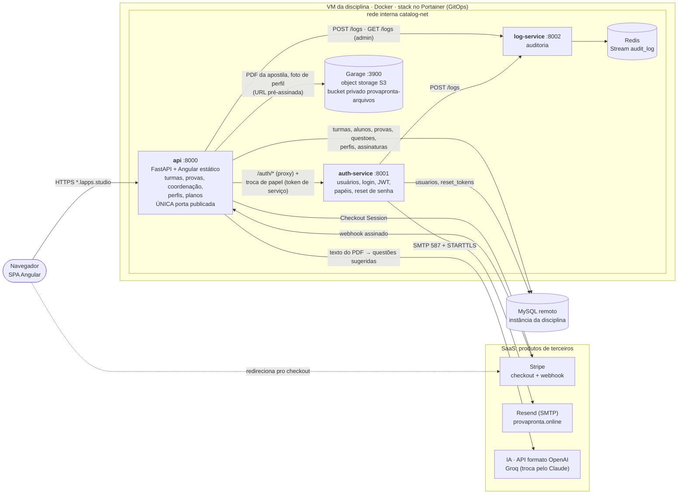
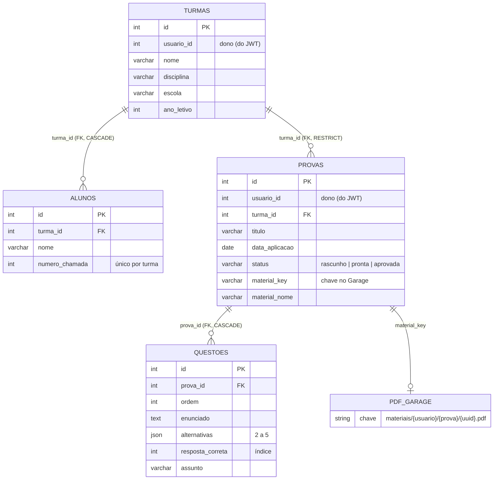

# ProvaPronta

**Provas de múltipla escolha prontas em minutos: o professor organiza as turmas, monta a prova com gabarito, anexa a apostila em PDF e, no plano Pro, gera uma versão B embaralhada contra cola.**

🌐 **No ar:** https://leonardo-oliveira-isw055.lapps.studio
📘 **API (Swagger):** https://leonardo-oliveira-isw055.lapps.studio/docs

> Projeto da disciplina ISW055 (Introdução à Computação em Nuvem), proposto pelo professor [@siriani](https://github.com/siriani) — [github.com/siriani](https://github.com/siriani).
>
> **Atividade 10 — "Seu negócio no ar":** o negócio do [plano de negócio](docs/plano-de-negocio.md) (atividade 9) rodando na mesma stack do Portainer, com o mesmo subdomínio e os mesmos limites de 1 GB. Este repositório é um espelho, com todo o histórico, do [repositório das atividades 1 a 8](https://github.com/leonardoricci-tsi/api_filme_); a arquitetura foi reaproveitada inteira e o domínio é novo.

### Conta de demonstração

| E-mail | Senha | Plano |
|---|---|---|
| `marta@provapronta.demo` | `ProvaPronta2026` | Professor Pro, com a turma "1º A — Biologia", 5 alunos e 2 provas |
| `coordenacao@provapronta.demo` | `ProvaPronta2026` | Escola (coordenadora Helena), com uma prova pronta para aprovar, uma aprovada e o relatório |

Criadas pela seed [`db/002_seed_dominio.sql`](db/002_seed_dominio.sql) (a Marta é a persona do plano de negócio). Para ver o plano Free, crie uma conta nova pelo site: todo cadastro nasce no Free.

---

## Sumário
1. [O que está no ar](#1-o-que-está-no-ar)
2. [Requisitos da atividade 10](#2-requisitos-da-atividade-10)
3. [Arquitetura](#3-arquitetura)
4. [Domínio: tabelas, migration e seed](#4-domínio-tabelas-migration-e-seed)
5. [Papéis e permissões (403)](#5-papéis-e-permissões-403)
6. [Isolamento por usuário (404)](#6-isolamento-por-usuário-404)
7. [Eventos de auditoria](#7-eventos-de-auditoria)
8. [Upload no object storage](#8-upload-no-object-storage)
9. [Como rodar](#9-como-rodar)
10. [Deploy em produção](#10-deploy-em-produção)
11. [Documentação](#11-documentação)

---

## 1. O que está no ar

| Tela | Rota | O que faz |
|---|---|---|
| Landing pública | `/` | Proposta de valor, como funciona, recursos, planos, FAQ e o botão **Criar conta grátis** |
| Entrar · Criar conta · Esqueci a senha | `/login`, `/registro`, `/esqueci-senha` | Conta própria (JWT); o "esqueci a senha" manda um e-mail com a marca, de `no-reply@provapronta.online` |
| Minhas provas | `/app/provas` | Lista com filtro por turma, selo rascunho/pronta e marca de PDF anexado |
| Nova / editar prova | `/app/provas/nova`, `/app/provas/:id/editar` | Editor de questões: enunciado, 2 a 5 alternativas, a correta marcada, assunto, reordenar; **gerar questões a partir do PDF com IA** (Pro) |
| Detalhe da prova | `/app/provas/:id` | Gabarito destacado, **PDF da apostila** (enviar, abrir, trocar, remover), **gerar versão B** (Pro), **aprovar** (Escola), apagar |
| Materiais | `/app/materiais` | Biblioteca de PDFs em **pastas** (ex.: "1º ano — Matemática — 1º bimestre"): enviar vários de uma vez, abrir, remover, renomear e apagar a pasta |
| Minhas turmas · Detalhe da turma | `/app/turmas`, `/app/turmas/:id` | Turmas, alunos com nº de chamada, provas da turma |
| Relatório da coordenação | `/app/relatorio` | Totais, provas por turma e por situação, questões por assunto (Escola) |
| Planos | `/app/planos` | Free, Professor Pro e Escola, com checkout do Stripe (modo de teste) |
| Perfil | `/app/perfil` | Foto, bio e selo do plano |
| Admin | `/app/admin` | Usuários e papéis, e os eventos de auditoria do log-service |

Tema claro e escuro (segue o sistema; troca no menu do avatar) e layout que funciona no celular.

**Gerar questões do PDF (Pro):** o professor escolhe a fonte — **uma pasta inteira** da biblioteca, **um PDF**, **vários PDFs** (de pastas diferentes) e/ou o PDF anexado à prova. A API extrai o texto (`pypdf`), reparte o espaço entre os arquivos para todos entrarem, e pede a um modelo de linguagem questões de múltipla escolha com gabarito e assunto. Elas voltam como **sugestão** para o editor — nada é gravado até o professor revisar e salvar. O provedor é configurável por variável de ambiente (`LLM_API_KEY`, `LLM_BASE_URL`, `LLM_MODEL`, API no formato da OpenAI): hoje o Groq; trocar pelo Claude é só configuração.

**Roadmap** (no plano de negócio, ainda não construído): correção por foto do gabarito e banco de questões.

## 2. Requisitos da atividade 10

| # | Requisito | Onde está |
|---|---|---|
| R1 | Stack aponta para o repositório novo | Stack do Portainer recriada apontando para este repositório (Portainer CE não deixa editar a URL do Git; a stack foi recriada com o mesmo nome, mantendo os volumes). GitOps: [`docker-compose.portainer.yml`](docker-compose.portainer.yml) |
| R2 | ≥ 3 tabelas de domínio com FK, por migration + seed versionados | `turmas`, `alunos`, `provas`, `questoes` em [`db/001_dominio.sql`](db/001_dominio.sql), aplicado pela migration [`a7c9e1f3b5d7`](alembic/versions/a7c9e1f3b5d7_dominio_provapronta.py); seed em [`db/002_seed_dominio.sql`](db/002_seed_dominio.sql) |
| R3 | CRUD do recurso principal | `/provas` e `/turmas` (listar, criar, detalhar, editar, apagar) — [`app/routers/provas.py`](app/routers/provas.py), [`app/routers/turmas.py`](app/routers/turmas.py) |
| R4 | Telas de listar, criar, detalhe e editar | Provas e turmas no Angular — [`frontend/src/app/features/provas`](frontend/src/app/features/provas), [`features/turmas`](frontend/src/app/features/turmas) |
| R5 | ≥ 3 papéis, ação proibida dá 403 mesmo pela API | 3 papéis de negócio com ações próprias — Free, Pro (versão B, sem limites) e Escola (aprovar prova, relatório) — mais o admin. [Seção 5](#5-papéis-e-permissões-403); `require_papel_minimo` em [`app/auth/dependencies.py`](app/auth/dependencies.py) |
| R6 | Isolamento por usuário: recurso de outro dá 403/404 | [Seção 6](#6-isolamento-por-usuário-404) — `get_owned_or_404` em [`app/routers/_ownership.py`](app/routers/_ownership.py) |
| R7 | Eventos de negócio no log-service | [Seção 7](#7-eventos-de-auditoria) |
| R8 | Upload no MinIO/Garage ligado a um registro | PDF da apostila ligado à prova — [Seção 8](#8-upload-no-object-storage) |
| R9 | Landing pública com proposta de valor e cadastro | [`/`](https://leonardo-oliveira-isw055.lapps.studio) — [`features/landing`](frontend/src/app/features/landing) |
| R10 | Nada do domínio anterior no código ou nas telas; variável da API externa removida da stack | Telas, serviços, rotas, modelos e testes do domínio anterior removidos; a variável da API externa saiu do compose e do Portainer; bucket, banco do CI e painel do Grafana renomeados |

Os testes automatizados cobrem R3, R5, R6, R7 e R8 (`tests/test_turmas.py`, `tests/test_provas.py`, `tests/test_material.py`, `tests/test_coordenacao.py`), e o smoke test do CI sobe a stack inteira e repete o fluxo de verdade: cria turma, cria prova, envia o PDF, abre pelo link pré-assinado, outro usuário leva 404 e o Free leva 403 na versão B ([`scripts/smoke-test.sh`](scripts/smoke-test.sh)).

## 3. Arquitetura



| Serviço | Pasta · imagem (GHCR) | Responsabilidade |
|---|---|---|
| **api** | `app/` + `frontend/` · `provapronta` | Porta de entrada pública: serve o Angular, a API do negócio (turmas, alunos, provas, PDF, versão B), perfis, planos e admin; repassa `/auth/*` e os arquivos do Garage |
| **auth-service** | `auth-service/` · `provapronta-auth` | Cadastro, login, JWT, papéis, redefinição de senha por e-mail |
| **log-service** | `log-service/` · `provapronta-log` | Grava e devolve os eventos de auditoria (Redis Stream `audit_log`) |
| **Garage** | `garage/` · `provapronta-garage` | Object storage S3 com bucket privado |
| **Redis** | `redis:7-alpine` | Guarda o log de auditoria |
| **MySQL** | fora da stack | Banco da disciplina, compartilhado pelos dois serviços, cada um com o seu histórico do Alembic |

**Equivalências com o enunciado:** o object storage é o **Garage** no lugar do MinIO (mesma API S3; o código usa `boto3` puro e trocar seria só configuração) e o banco é o **MySQL remoto** da disciplina no lugar do MariaDB.

**Camadas de nuvem:** a VM da disciplina é **IaaS**; os containers (api, auth-service, log-service, Redis, Garage), o MySQL da disciplina e o GitHub Actions são **PaaS** (eu entrego imagem e workflow, a plataforma roda); Stripe, Resend, GitHub/GHCR e o proxy HTTPS do domínio são **SaaS**.

## 4. Domínio: tabelas, migration e seed



- **DDL versionado:** [`db/001_dominio.sql`](db/001_dominio.sql), aplicado pela migration do Alembic [`a7c9e1f3b5d7`](alembic/versions/a7c9e1f3b5d7_dominio_provapronta.py) (que lê o `.sql`), com `downgrade` que apaga as quatro tabelas.
- **Regras no banco:** apagar a turma leva os alunos junto (`CASCADE`), mas **não** apaga provas (`RESTRICT`; a API responde `409`). Apagar a prova leva as questões junto, e a API apaga o PDF no Garage depois do commit.
- **Seed:** [`db/002_seed_dominio.sql`](db/002_seed_dominio.sql) cria a professora Marta (Pro), a turma, 5 alunos, uma prova pronta com 3 questões e um rascunho. Pode rodar de novo: apaga e recria só os dados dela.

## 5. Papéis e permissões (403)

Os papéis formam uma escada, cada um inclui os anteriores: `professor` (Free) < `professor_pro` < `coordenador` (Escola) < `admin`. O papel vem **só** do claim `role` do JWT, e quem barra é a API — as telas apenas escondem botões.

| Ação | Free (`professor`) | `professor_pro` | `coordenador` | `admin` |
|---|---|---|---|---|
| Turmas, alunos, provas, PDF (CRUD dos próprios) | ✅ até 1 turma e 2 provas/mês | ✅ ilimitado | ✅ ilimitado | ✅ |
| Criar a 2ª turma / a 3ª prova do mês / o 4º PDF da biblioteca | **403** `acesso_negado:limite_free:*` | ✅ | ✅ | ✅ |
| `POST /provas/{id}/versao-b` | **403** `Ação exige papel 'professor_pro' ou superior` | ✅ | ✅ | ✅ |
| `POST /provas/{id}/gerar-questoes` (IA) | **403** | ✅ | ✅ | ✅ |
| `POST /provas/{id}/aprovar` | **403** | **403** `Ação exige papel 'coordenador' ou superior` | ✅ | ✅ |
| `GET /coordenacao/relatorio` | **403** | **403** | ✅ | ✅ |
| `GET /admin/logs`, `/auth/admin/users` | **403** | **403** | **403** | ✅ |

**Aprovar prova:** só prova `pronta` pode ser aprovada (`409` para rascunho ou já aprovada). O status `aprovada` não pode ser enviado no corpo de `POST`/`PATCH /provas` (`422`), então ninguém se autoaprova pela API; e editar uma prova aprovada a devolve para `pronta`.

Os planos pagos são vendidos pelo Stripe: o webhook assinado troca o papel no auth-service (`professor` → `professor_pro` ou `coordenador`). Testes: `tests/test_provas.py` (versão B e limite de provas), `tests/test_turmas.py` (limite de turmas), `tests/test_coordenacao.py` (aprovar e relatório) e `tests/test_premium_*.py`.

## 6. Isolamento por usuário (404)

Toda consulta do domínio filtra pelo dono **na query** (`usuario_id` do JWT), nunca pela tela. Turma ou prova de outro professor responde **`404`**, como se não existisse (`403` revelaria que o ID existe):

- `GET/PATCH/DELETE /provas/{id}`, `/provas/{id}/material`, `/provas/{id}/versao-b`, `/provas/{id}/aprovar` e `/turmas/{id}` de outra pessoa → `404` (nem o coordenador aprova prova de outra pessoa);
- criar prova numa turma de outra pessoa → `404`;
- `GET /provas?turma_id=<de outra pessoa>` → lista vazia;
- pasta ou PDF da biblioteca de outra pessoa (ver, enviar, abrir, apagar, ou usar para gerar questões) → `404`;
- aluno não tem dono próprio: é da turma, e a turma é conferida pelo dono antes de adicionar ou remover.

O PDF tem a mesma regra: o link pré-assinado só é gerado para o dono da prova. Testes: `test_*_de_outro_*` em `tests/test_turmas.py`, `tests/test_provas.py` e `tests/test_material.py`.

## 7. Eventos de auditoria

A api e o auth-service mandam `POST /logs` para o log-service (fire-and-forget: se ele cair, a ação do usuário continua). Cada evento tem `usuario_id`, `acao`, `timestamp` (UTC) e `ip`. Só admin consulta (`GET /admin/logs`, ou a aba **Eventos de auditoria** do painel).

| Evento | Quando |
|---|---|
| `turma_criada:{id}`, `turma_editada:{id}`, `turma_removida:{id}` | CRUD de turma |
| `aluno_adicionado:turma:{t}:aluno:{a}`, `aluno_removido:turma:{t}:aluno:{a}` | Alunos da turma |
| `prova_criada:{id}`, `prova_editada:{id}`, `prova_removida:{id}` | CRUD de prova |
| `prova_versao_b:{original}:nova:{nova}` | Versão B gerada (Pro) |
| `questoes_geradas:prova:{id}:{n}:pdfs:{k}` | Questões sugeridas pela IA a partir de k PDFs (Pro) |
| `pasta_criada:{id}`, `pasta_renomeada:{id}`, `pasta_removida:{id}`, `materiais_enviados:pasta:{id}:{n}`, `material_removido:{id}` | Biblioteca de materiais |
| `prova_aprovada:{id}`, `relatorio_coordenacao_consultado` | Ações da coordenação (Escola) |
| `material_enviado:prova:{id}`, `material_removido:prova:{id}` | PDF da apostila |
| `acesso_negado:{papel}`, `acesso_negado:limite_free:{turmas\|provas}`, `acesso_negado:admin`, `acesso_negado:perfil:{id}` | Toda ação barrada com 403 |
| `abrir_checkout:{plano}`, `plano_ativado:{plano}`, `plano_cancelado:{plano}` | Assinatura (Stripe) |
| `login`, `logout`, `atualizar_perfil`, `upload_foto_perfil` | Conta e perfil |

## 8. Upload no object storage

O **PDF da apostila** fica ligado à prova:

1. `POST /provas/{id}/material` (multipart) — até **10 MB**; o tipo é conferido pelos bytes (`%PDF-`), não pela extensão (um `.exe` renomeado leva `415`).
2. O arquivo vai para o bucket privado `provapronta-arquivos`, na chave `materiais/{usuario_id}/{prova_id}/{uuid}.pdf`, gerada pelo servidor. O MySQL guarda só a chave (`provas.material_key`) e o nome original para exibir.
3. `GET /provas/{id}/material` devolve uma **URL pré-assinada** que expira; o navegador abre pelo próprio domínio do site e a api repassa para o Garage (`app/routers/storage_proxy.py`). Sem a assinatura, o Garage recusa.
4. Trocar o PDF apaga o antigo; apagar a prova apaga o PDF.

A foto de perfil segue o mesmo caminho (JPEG/PNG/WEBP até 2 MB, redimensionada e sem EXIF).

## 9. Como rodar

### Tudo com Docker Compose (recomendado)

```bash
cp .env.example .env        # preencha: DATABASE_URL, JWT_SECRET, SMTP_*, GARAGE_RPC_SECRET, S3_*, GRAFANA_ADMIN_PASSWORD
docker compose up -d --build
docker compose run --rm migrate        # api: domínio, perfis, assinaturas
docker compose run --rm migrate-auth   # auth-service: usuarios, papéis, reset_tokens
mysql -h HOST -u USUARIO -p BANCO < db/002_seed_dominio.sql   # opcional: conta da Marta
```

- Site e API em http://localhost:8000 (Swagger em `/docs`); Grafana em http://127.0.0.1:3000 com o painel "ProvaPronta — saúde e métricas".
- Só a `api` publica porta; auth-service, log-service, Redis e Garage ficam na rede interna.
- O Garage cria a chave e o bucket `provapronta-arquivos` sozinho no primeiro boot.
- Para desenvolver o Angular com hot-reload: `cd frontend && npm install && npm start` (http://localhost:4200, com proxy para a `:8000`).

### Testes

```bash
pytest -q                                   # api: SQLite em memória, auth/log mockados (respx)
cd log-service && python -m pytest -q       # log-service: fakeredis
cd frontend && npx ng test --watch=false    # frontend
scripts/smoke-test.sh http://localhost:8000 # stack inteira de pé (o mesmo do CI)
```

## 10. Deploy em produção

`git push` na `main` → o GitHub Actions roda os testes, builda as 4 imagens, sobe a stack inteira num smoke test com um MySQL descartável, publica no GHCR com a tag `sha-xxxxxxx` e faz um commit `deploy: sha-xxxxxxx [skip ci]` apontando o [`docker-compose.portainer.yml`](docker-compose.portainer.yml) para essas tags. O Portainer (GitOps, a cada 5 min) percebe a mudança e recria os containers. Por causa desse commit automático, faça `git pull --rebase` antes de cada `git push`.

**Migrations em produção** são manuais, depois do deploy: Portainer → Containers → container da `api` → Console (`bash`) → `alembic upgrade head`; o mesmo no container do `auth-service` quando houver migration nova nele. A seed roda uma vez, com o cliente `mysql` apontando para o banco da disciplina.

**Segredos** ficam só nas variáveis de ambiente da stack no Portainer (`DATABASE_URL`, `JWT_SECRET`, `SMTP_*`, `GARAGE_RPC_SECRET`, `S3_*`, `STRIPE_*`), nunca no repositório. E-mail em produção: Resend por SMTP, com o domínio `provapronta.online` verificado (DKIM, SPF e DMARC).

## 11. Documentação

- [Plano de negócio](docs/plano-de-negocio.md) — dor, persona, concorrentes, proposta de valor, receita, métricas, Lean Canvas e LGPD (atividade 9).
- [Documentação do sistema](DOCUMENTACAO.md) — especificação, arquitetura, regras de negócio com o arquivo de origem e modelo de dados.
- API: `/docs` (Swagger) na api; contratos internos em [`docs/openapi/`](docs/openapi).
